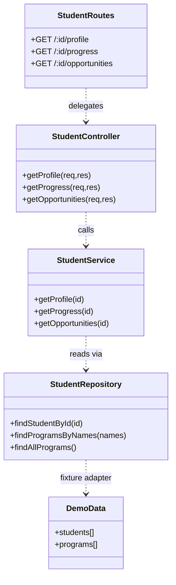

# Assignment 5 — Layered server (implementation prototype)

The current persistence layer uses a **demo data fixture**. PostgreSQL/SQLite and authentication are not integrated yet. This diagram reflects the files introduced for Assignment 5, not future features.
